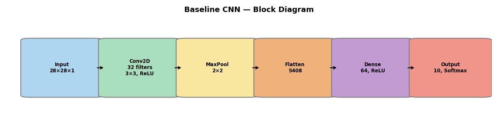
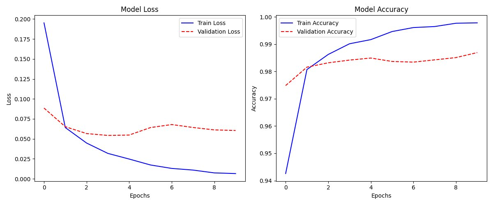

# Baseline CNN for MNIST Digit Classification

A deliberately minimal convolutional neural network for handwritten digit recognition, built as a reference point for comparing deeper architectures and transfer learning later on.

**Result: 98.63% test accuracy** with a single convolutional block and ~347K parameters.

## Architecture



| Layer | Type / Config | Output shape | Parameters |
|---|---|---|---|
| Conv_1 | Conv2D, 32 filters, 3×3, ReLU | (26, 26, 32) | 320 |
| MaxPool_1 | MaxPooling2D, 2×2 | (13, 13, 32) | 0 |
| Flatten | Flatten | (5408) | 0 |
| Dense_1 | Dense, 64 units, ReLU | (64) | 346,176 |
| Output | Dense, 10 units, Softmax | (10) | 650 |

## Training setup

| Parameter | Value |
|---|---|
| Dataset | MNIST (60,000 train / 10,000 test) |
| Optimizer | Adam (learning rate 0.001) |
| Loss | Sparse categorical cross-entropy |
| Batch size | 32 |
| Epochs | 10 |
| Validation split | 20% |

## Results



| Metric (test set) | Score |
|---|---|
| Accuracy | 0.9863 |
| Precision (macro) | 0.9863 |
| Recall (macro) | 0.9861 |
| F1-score (macro) | 0.9862 |
| ROC-AUC (one-vs-rest) | 0.9999 |

## What I learned

- **Fast early learning:** training accuracy jumped from ~94% to ~98% within the first two epochs; validation accuracy plateaued at ~98.7% from epoch 4.
- **Mild overfitting:** validation loss bottomed out around epochs 3–4 (~0.054) and then crept up to ~0.060–0.068, while training loss kept falling to ~0.006.
- **Next steps to reduce it:** dropout (0.3–0.5), L2 regularisation, data augmentation, early stopping, and a second convolutional block.

## How to run

```bash
pip install -r requirements.txt
python mnist_baseline_cnn.py
```

MNIST downloads automatically on the first run. Plots are saved to `images/`, and the test metrics are printed to the console. Results may differ slightly between runs and hardware.

## Tech stack

Python · TensorFlow / Keras · scikit-learn · pandas · Matplotlib
